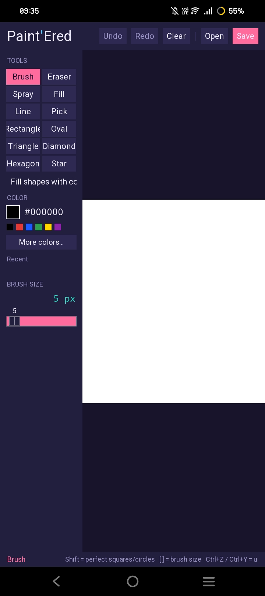

# Paint'Ered

A desktop paint application made with **Python, Tkinter and Pillow**.
It started from the "Build a Paint Application" lesson, then I added the weekly requirements, extra features and a new design.

## How to run

```bash
python -m pip install pillow
python paint_application.py
```

## Screenshot of the whole UI



> Run the program, draw something, and save a screenshot of the whole window as `screenshot.png` in this folder.

---

## REQUIREMENTS COMPLETED

### 1. Bigger brush range (5 pts)

The brush size is a slider bar (`tk.Scale`) like the one in the lesson. It used to go from 1 to 30. I changed the `to_` value to 100, so the bar now covers 1 (thinnest) to 100 (thickest), and the current number is shown above the handle. The saved image is the same size as the canvas (900 x 550) and looks the same as what is on screen, because the picture is stored in a Pillow image and the canvas only displays it.

Original code:

```python
size_slider = tk.Scale(toolbar, from_=1, to=30, orient="horizontal",
                       command=change_brush_size, length=100,
                       bg=PEACH_PANEL, fg=TEXT_COLOR,
                       troughcolor=PEACH_BUTTON, highlightthickness=0)
```

New code:

```python
size_slider = tk.Scale(side, from_=1, to=100, orient="horizontal",
                       command=change_brush_size, length=190,
                       bg=PANEL, fg=TEXT, troughcolor=ACCENT, highlightthickness=0)
```

### 2. Undo button (15 pts)

Before every drawing action (a freehand stroke, a shape, a fill, Clear, Open) the program stores a copy of the Pillow image in a list called `undo_stack`. **Undo** takes the last copy out of that list and shows it again, so the most recent stroke or shape disappears. Shortcut: `Ctrl+Z`.

```python
def undo(event=None):
    redo_stack.append(image.copy())
    set_image(undo_stack.pop())
    refresh_canvas()
```

### 3. Filled shapes (20 pts)

A **Fill shapes with color** checkbox sits in the side panel. When it is ticked, rectangles, ovals and the other shapes are filled with the current color, both in the preview and in the saved image.

```python
if filled and name in FILLABLE:
    draw.polygon(points, fill=color)
```

### 4. Extra shape tools (20 pts)

I added **Triangle, Diamond, Hexagon and Star** (the task only asked for one). Each shape is a list of corner points that fits inside the box you drag. The same function (`shape_points`) is used for the live preview and for the final drawing in the Pillow image, so the shape is saved exactly as previewed.

### 5. Confirm before clearing (20 pts)

**Clear** opens a Yes / No dialog (`messagebox.askyesno`). **No** keeps the drawing. **Yes** clears it (and Undo can still bring it back).

```python
answer = messagebox.askyesno("Clear canvas",
                             "Are you sure you want to clear the whole canvas?")
if not answer:
    return
```

### 6. Quick colors (20 pts)

Six one-click color swatches in the side panel: **black, red, blue, green, yellow, purple**. Clicking one changes the drawing color immediately. The big swatch above them shows the active color.

```python
QUICK_COLORS = [("Black", "#000000"), ("Red", "#E53935"), ("Blue", "#1E5BFF"),
                ("Green", "#2E9E4F"), ("Yellow", "#FFD600"), ("Purple", "#8E24AA")]
```

---

## Extra features I added

| Feature | How to use it |
|---|---|
| Redo | **Redo** button or `Ctrl+Y` |
| Fill bucket | Pick **Fill**, click an area |
| Eyedropper | Pick **Pick**, click any color on the canvas |
| Spray can | Pick **Spray**, drag |
| Perfect shapes | Hold `Shift` while dragging (squares, circles, 45-degree lines) |
| Brush-size ring | A circle on the canvas shows the exact brush size |
| Recent colors | Custom colors are remembered under "Recent" |
| Status bar | Shows the active tool and mouse position |
| Keyboard shortcuts | `B` brush, `E` eraser, `S` spray, `F` fill, `L` line, `R` rectangle, `O` oval, `T` triangle, `D` diamond, `H` hexagon, `A` star, `I` eyedropper, `[` / `]` brush size, `Ctrl+S` save, `Ctrl+O` open |
| Open without stretching | Opened pictures keep their proportions |

## New design

The peach theme was replaced with a dark "midnight indigo" theme with pink and teal highlights. The tools, colors and brush size are in a side panel, file actions are in a header bar, and the canvas (white paper, so the eraser still matches) sits in the middle. All colors are named constants at the top of `paint_application.py` (`BG`, `PANEL`, `CARD`, `HOVER`, `ACCENT`, `TEXT`, `MUTED`), so the look can be changed in one place.
